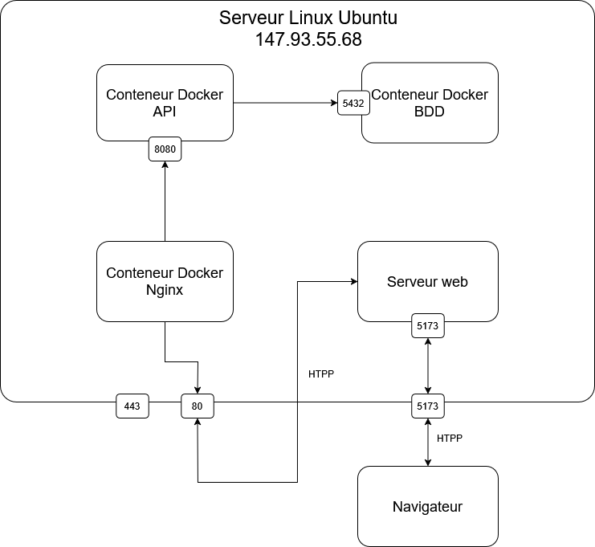

# TP 8 Automatisation

## Architecture Technique & Choix Logiciels

### Stack Logique
* **Front-end :** React.js (Interface utilisateur).
* **Back-end :** Spring Boot 3 (Java 17/21) - API REST.
* **Base de Données :** PostgreSQL (Persistance relationnelle).
* **Algorithmique de bin packing:** `skjolber-packing` (Optimisation 3D via bin-packing).

### Architecture du Code (N-Tier)
1. **Controller Layer :** Endpoints REST, gestion des DTOs (Conversion `Placement` -> `ProductPlacement`).
2. **Service Layer :** Logique métier (Calculs de picking, orchestration du packing).
3. **Repository Layer :** Abstraction JPA/Hibernate (Ex: `findAllProductBySupportID`).
4. **Model Layer :** Entités JPA (Entité `Support` avec `columnDefinition="text"`).

## Schéma de Déploiement & Infrastructure



## Déploiement

Pour le déploiement de l'application, nous n'avons initialement pas pris en compte le fait de poster le serveur web sur le serveur car le front aurait dû être un client lourd sur l'ordinateur du client, mais il s'est avéré que le temps nous a forcés à nous rabattre sur un client web plus léger.

Ainsi, nous avons eu besoin de trois conteneurs Docker, un pour l'API en elle-même, un pour la base de données et enfin un dernier pour un reverse proxy dans l'unique but de ne pas avoir à taper le port 8080 précisément du serveur et simplement le port 80.

En ce qui concerne le reverse proxy, il a fallu ajouter un fichier de [configuration Nginx](./API_Aramis/nginx/nginx.conf) et le tour était joué :

```
events {
    worker_connections 1024;
}

http {
    upstream spring-backend {
        server api:8080;
    }

    server {
        listen 80;

        # En production, mets ton nom de domaine ici (ex: api.aramis.com)
        # server_name api.aramis.com;

        location / {
            proxy_pass http://spring-backend;

            proxy_set_header Host $host;

            proxy_set_header X-Real-IP $remote_addr;
            proxy_set_header X-Forwarded-For $proxy_add_x_forwarded_for;

            proxy_set_header X-Forwarded-Proto $scheme;
        }
    }
}
```

Pour l'API il a fallut prévoir un [Dockerfile](./API_Aramis/Dockerfile) pour gérer les fichier de configurations. Mais comme le projet springboot prend compte des variables d'environnement, il a également fallut les ajouter à gitlab. Pour ce faire il faut se rendre dans les paramètres du projet et [`CI / CD`](https://gitlab.iut-valence.fr/delbovea/sae-s5-beroud-bloise-delbove-kebaili/-/settings/ci_cd#js-cicd-variables-settings). Sur cette page il y a la possiblité d'ajouter des varaible d'environnement utilisées pendant les jobs de CI / CD.

Enfin pour simplifier la tâche de CI que vous verrez plus bas, un [docker compose](./API_Aramis/docker-compose.yml) a été mis en place. Celui-ci nous a permis de simplifier au maximum les informations saisies dans le `gitlab-ci.yml` et donc le rendre le plus compréhensible possible.

## CI / CD

POur nous faciliter la tapche du déploiement nous avons mis une CI / CD en palce à l'aide d'un runner gitlab.

Voici le [gitlab-ci.yml](./.gitlab-ci.yml) :

```
stages:
  - build
  - test
  - deploy

variables:
  MAVEN_OPTS: "-Dmaven.repo.local=.m2/repository"

cache:
  paths:
    - .m2/repository

build_job:
  stage: build
  script:
    - echo "Compilation de l'application avec Maven..."
    - cd API_Aramis
    - mvn clean package -DskipTests
  artifacts:
    paths:
      - target/*.jar
    expire_in: 1 hour

test_job:
  stage: test
  script:
    - echo "Exécution des tests unitaires..."

deploy_job:
  stage: deploy
  only:
    - main  # Le déploiement ne se fait que lors d'un push sur la branche main
  script:
    - echo "Déploiement de l'infrastructure avec Docker Compose..."
    - cd API_Aramis
    - docker compose down
    - docker compose up --build -d
    - echo "Application déployée avec succès !"
```

On peut y voir plusieurs jobs : `build`, `test` et `deploy`. Actuellement, les deux jobs qui sont réellement utiles sont `build` et `deploy`, `test` n'est pas du tout utilisé mais a été prévu dans l'optique d'intégration de tests dans la CI.

## Git workflow

Pour simplifier la gestion du projet, un git workflow a été mis en place avec une branche de production : `main`, deux branches de développement / test : `dev-frontend` et `dev-api`. Chaque fonctionnalité avait sa branche dédiée et les tâches étaient gérées via le système d'issues de GitLab. Chaque équipe (front et back) procédait à des vérifications internes du travail en chaque membre. Autrement dit, quand un membre de l'équipe backend créait une merge request, un autre membre devait d'abord passer par dessus avant de l'accepter pour avoir un regard objectif sur ce qui a été produit.